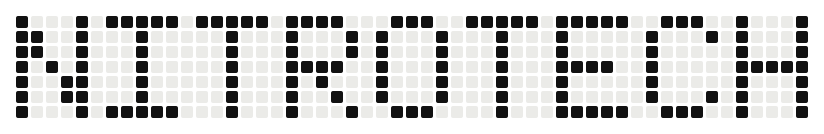
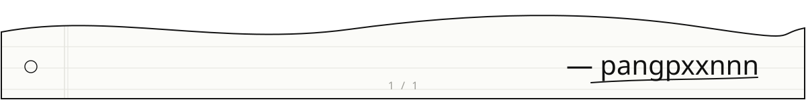

<a href="https://github.com/pangpxxnnn">
  <picture>
    <source media="(prefers-color-scheme: dark)" srcset="https://readme-typing-svg.demolab.com?font=Special+Elite&size=22&duration=2800&pause=900&color=F2F2F2&center=true&vCenter=true&width=560&lines=Building+things+for+the+web;Vue+%2B+Vite+on+the+front;Go+%2C+PHP+%26+Node.js+on+the+back;Shipped+with+Docker+on+Ubuntu" />
    
  </picture>
</a>

 

  I build web apps end to end, from the UI down to the server it runs on. 
  Mostly personal projects. Mostly for fun.

<a href="https://www.instagram.com/pangpxxnnn">
  <picture>
    <source media="(prefers-color-scheme: dark)" srcset="./assets/instagram-dark.svg" />
    
  </picture>
</a>
<a href="https://www.facebook.com/pdc.creation.inc">
  <picture>
    <source media="(prefers-color-scheme: dark)" srcset="./assets/facebook-dark.svg" />
    
  </picture>
</a>

<h3>Stack</h3>

<picture>
  <source media="(prefers-color-scheme: dark)" srcset="./assets/stack-dark.svg" />
  
</picture>

  

<picture>
  <source media="(prefers-color-scheme: dark)" srcset="./assets/nitrotech-snake-dark.svg" />
  
</picture>

